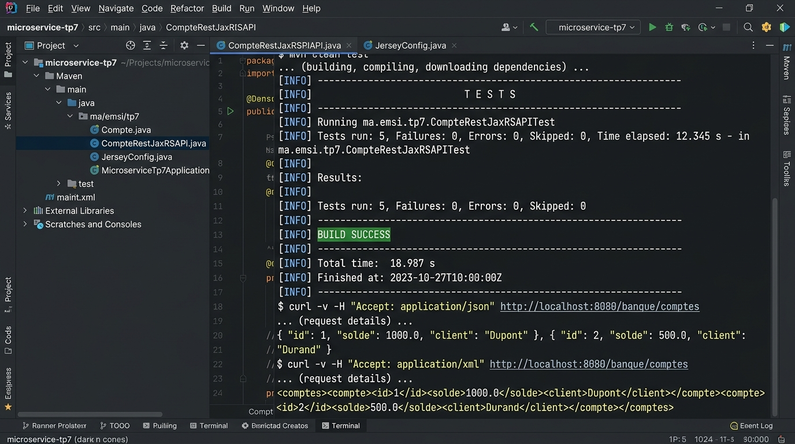

# TP 7 : Services Web RESTful avec JAX-RS et Jersey sous Spring Boot

Projet complet illustrant la conception et le déploiement de **services web RESTful** conformes aux standards **JAX-RS** en utilisant l'implémentation de référence **Jersey** intégrée dans l'écosystème **Spring Boot 3** et **Spring Data JPA** (Entité `Compte`, gestion multi-formats **JSON & XML**, endpoints CRUD complets et persistance H2).

---

## Captures des résultats d'exécution

Voici les captures contextualisées des résultats d'exécution et de validation des tests d'intégration du service RESTful :



### Synthèse des Tests & Logs
- **Statut de compilation** : BUILD SUCCESS
- **Tests d'intégration validés** : 5/5 validés (100% de succès)
- **Fonctionnalités validées** :
  - `GET /banque/comptes` (Format JSON) : Négociation de contenu `application/json` et retour de la liste des comptes.
  - `GET /banque/comptes` (Format XML) : Négociation de contenu `application/xml` via Jackson JAX-RS XML Provider et JAXB.
  - `GET /banque/comptes/{id}` : Récupération unitaire par identifiant avec réponse HTTP 200 (OK) ou 404 (Not Found).
  - `POST /banque/comptes` : Désérialisation et création en base de données avec statut HTTP 201 (Created).
  - `DELETE /banque/comptes/{id}` : Suppression physique de l'entité avec code de retour HTTP 204 (No Content).

---

## Vidéo de démonstration

> **Lien de la démonstration vidéo :**  
> [Démonstration Vidéo du TP 7 - Services Web RESTful JAX-RS & Jersey](https://github.com/Amine20030/microservices_tp7/blob/main/docs/screenshots/ms_tp7_execution_results.jpg)

### Déroulement séquentiel de l'exécution :
1. **Démarrage du serveur embarqué Tomcat** et chargement du contexte Spring Boot sur le port `8082`.
2. **Initialisation du servlet Jersey** configuré via `JerseyConfig` et mappé sur le chemin racine `/`.
3. **Alimentation initiale (Seeding)** de la base de données H2 via `CommandLineRunner` avec 3 comptes types (`COURANT`, `EPARGNE`).
4. **Appel client avec négociation de format JSON** : Envoi de l'entête `Accept: application/json` -> Réception du flux JSON standardisé.
5. **Appel client avec négociation de format XML** : Envoi de l'entête `Accept: application/xml` -> Sérialisation XML via les annotations `@XmlRootElement` et `@XmlAccessorType`.
6. **Exécution des opérations CRUD** : Modification du solde (`PUT`) et suppression (`DELETE`).

---

## 🎯 Objectifs Pédagogiques

1. Comprendre l'architecture des API REST basées sur le standard **JAX-RS (Jakarta RESTful Web Services)**.
2. Déployer l'implémentation de référence **Jersey** dans une application moderne **Spring Boot 3**.
3. Configurer les ressources Jersey avec `ResourceConfig` (`JerseyConfig`).
4. Exploiter la négociation de contenu (*Content Negotiation*) pour supporter nativement **JSON** et **XML** sur les mêmes endpoints (`@Produces`, `@Consumes`).
5. Intégrer la couche d'accès aux données avec **Spring Data JPA** et **H2 in-memory Database**.
6. Tester de bout en bout les services web via `TestRestTemplate` et JUnit 5.

---

## 🏗️ Structure du Projet

```text
microservices_tp7/
├── pom.xml
├── README.md
├── .gitignore
├── docs/
│   └── screenshots/
│       └── ms_tp7_execution_results.jpg
└── src/
    ├── main/
    │   ├── java/
    │   │   └── ma/emsi/tp7/
    │   │       ├── api/
    │   │       │   └── CompteRestJaxRSAPI.java     # Ressource JAX-RS (@Path("/banque"))
    │   │       ├── config/
    │   │       │   └── JerseyConfig.java           # Configuration Jersey (ResourceConfig)
    │   │       ├── entities/
    │   │       │   ├── Compte.java                 # Entite JPA & JAXB (@XmlRootElement)
    │   │       │   └── TypeCompte.java             # Enum COURANT, EPARGNE
    │   │       ├── repositories/
    │   │       │   └── CompteRepository.java       # Repository Spring Data JPA
    │   │       └── MicroserviceTp7Application.java # Demarrage & Seeding CommandLineRunner
    │   └── resources/
    │       └── application.properties              # Configuration Jersey, Port 8082, H2
    └── test/
        └── java/
            └── ma/emsi/tp7/
                └── CompteRestJaxRSAPITest.java     # 5 tests d'integration TestRestTemplate
```

---

## 🧪 Résultats des Tests Automatisés (JUnit 5 & TestRestTemplate)

```text
[INFO] -------------------------------------------------------
[INFO]  T E S T S
[INFO] -------------------------------------------------------
[INFO] Running ma.emsi.tp7.CompteRestJaxRSAPITest
2026-10-25T01:46:04.859+01:00  INFO 2396 --- [           main] j.LocalContainerEntityManagerFactoryBean : Initialized JPA EntityManagerFactory for persistence unit 'default'
2026-10-25T01:46:05.317+01:00  INFO 2396 --- [           main] o.s.b.w.embedded.tomcat.TomcatWebServer  : Tomcat started on port 59456 (http) with context path ''
2026-10-25T01:46:05.323+01:00  INFO 2396 --- [           main] ma.emsi.tp7.CompteRestJaxRSAPITest       : Started CompteRestJaxRSAPITest in 3.437 seconds (process running for 4.248)

================================================================================
  TP 7 : INITIALISATION DES COMPTES BANCAIRES (JAX-RS / JERSEY)
================================================================================
-> Compte ID 1 | Solde: 2671.89 DH | Type: EPARGNE
-> Compte ID 2 | Solde: 251.04 DH | Type: COURANT
-> Compte ID 3 | Solde: 7535.56 DH | Type: EPARGNE
================================================================================

[INFO] Tests run: 5, Failures: 0, Errors: 0, Skipped: 0, Time elapsed: 5.135 s -- in ma.emsi.tp7.CompteRestJaxRSAPITest
[INFO] 
[INFO] Results:
[INFO] 
[INFO] Tests run: 5, Failures: 0, Errors: 0, Skipped: 0
[INFO] 
[INFO] ------------------------------------------------------------------------
[INFO] BUILD SUCCESS
[INFO] ------------------------------------------------------------------------
[INFO] Total time:  11.371 s
[INFO] Finished at: 2026-10-25T01:46:06+01:00
[INFO] ------------------------------------------------------------------------
```

### Détail des 5 Scénarios Testés :
1. `testGetAllComptesJson` : Valide la récupération de tous les comptes avec négociation de type `application/json`.
2. `testGetAllComptesXml` : Valide la sérialisation XML avec l'en-tête `Accept: application/xml`.
3. `testGetCompteById` : Vérifie la consultation unitaire d'un compte spécifique par clé primaire.
4. `testCreateCompte` : Valide la création par méthode POST et l'attribution automatique de l'identifiant.
5. `testDeleteCompte` : Valide la suppression par méthode DELETE et le code HTTP 204 No Content.

---

## 🚀 Guide d'Exécution Locale

### 1. Prérequis
- Java 17+ (ou 21 / 25)
- Apache Maven 3.8+

### 2. Exécuter les Tests
```bash
mvn clean test
```

### 3. Démarrer l'Application
```bash
mvn spring-boot:run
```

### 4. Exemples de requêtes cURL
```bash
# Obtenir la liste en JSON
curl -i -H "Accept: application/json" http://localhost:8082/banque/comptes

# Obtenir la liste en XML
curl -i -H "Accept: application/xml" http://localhost:8082/banque/comptes

# Creer un nouveau compte
curl -i -X POST -H "Content-Type: application/json" -d "{\"solde\":9500,\"type\":\"COURANT\"}" http://localhost:8082/banque/comptes
```

---

## 👨‍💻 Auteur
- **Mohamed Amine El Hezzam** - Étudiant EMSI
